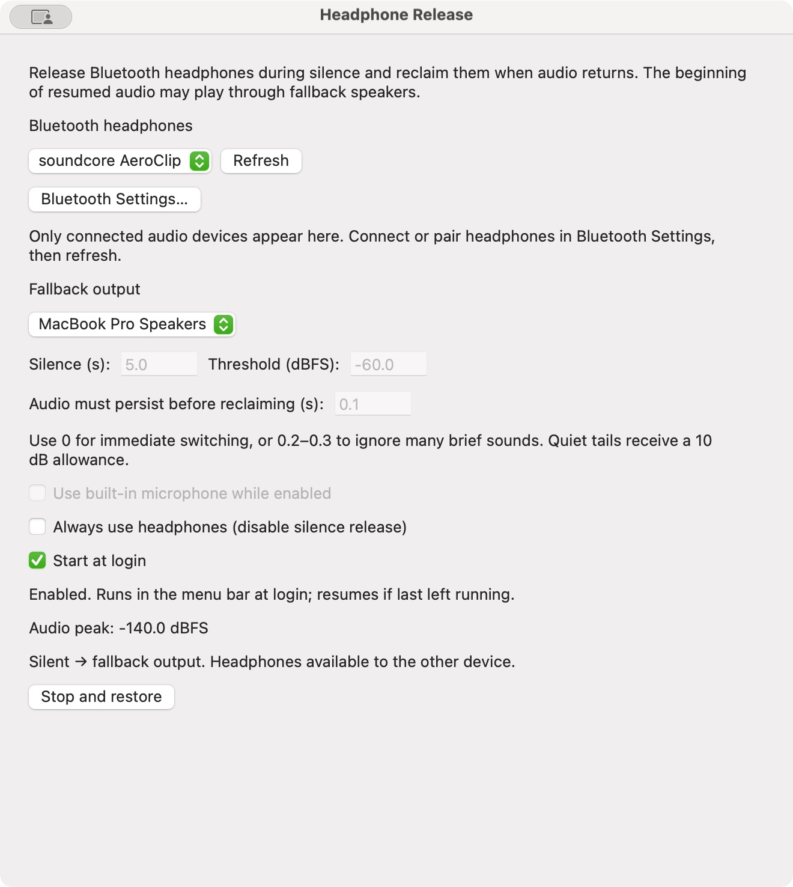
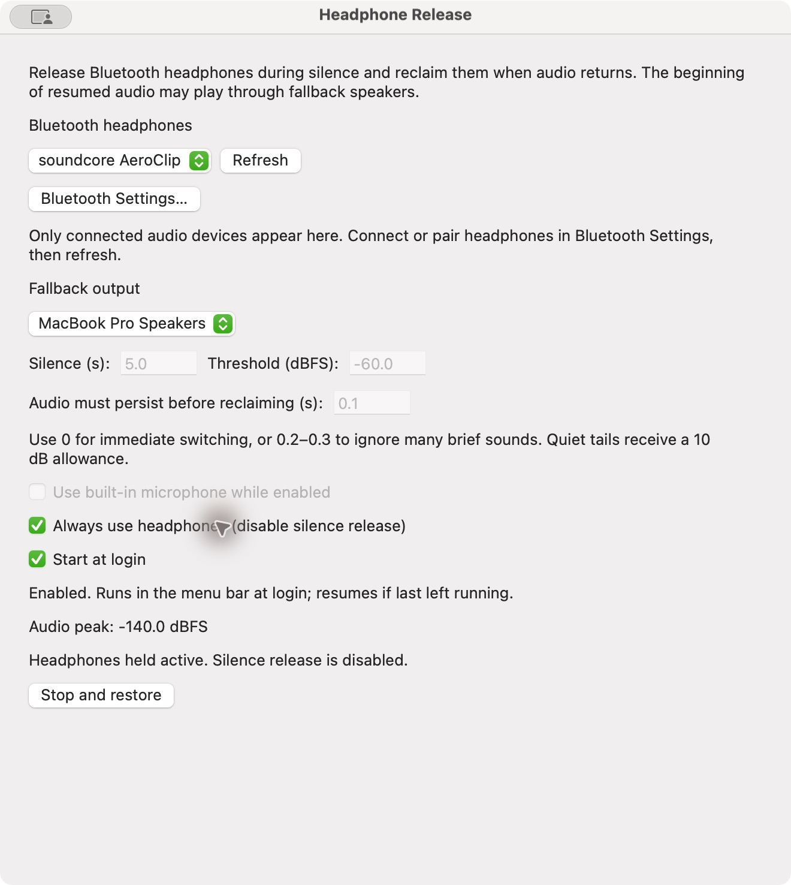

# Headphone Release

A small macOS menu bar app that lets Bluetooth multipoint headphones go idle when your Mac is silent.

[Download the latest Mac app](https://github.com/AMR-aa1405465/headphone-release/releases/latest)

## Screenshots

| Automatic release during silence | Always use headphones |
| --- | --- |
|  |  |

## The problem

Multipoint headphones can stay connected to a Mac and a phone at the same time. They are supposed to play audio from whichever device is active.

Sometimes the Mac keeps the headphones occupied even when nothing is playing. An app may keep an audio stream open and send silence, making it difficult for the phone to take over.

## The solution

I built Headphone Release to give the other device a chance to play without manually disconnecting Bluetooth every time.

The app checks actual audio samples instead of relying on an app's playback status. After a few seconds of silence, it switches the Mac's default output to a fallback device, usually the built-in speakers. When sound returns, it switches back to the headphones.

Bluetooth stays connected throughout. Whether this releases the headphones' multipoint priority depends on the headset and its firmware.

## Features

- Runs in the menu bar, without a Dock icon.
- Optional start at login, with automatic monitoring if last left enabled.
- Remembers your headphones and settings.
- Adjustable silence timeout, sound threshold, and reclaim delay.
- Keeps quiet passages from causing unnecessary switching.
- An **Always use headphones** override.
- Optional use of the Mac's built-in microphone.
- Recovery after sleep and headphone reconnection.
- Restores previous audio routes when stopped; attempts recovery on the next launch after a crash.

Audio is analyzed locally. It is not saved or uploaded.

## Build and install

Requires macOS 14.2 or later and Xcode Command Line Tools.

```sh
./build.sh
./test.sh
```

The build creates `Headphone Release.app` for your Mac's architecture. To cross-compile, use `TARGET_ARCH=arm64 ./build.sh` or `TARGET_ARCH=x86_64 ./build.sh`.

Move the app to **Applications**, then open it. Local builds are ad hoc signed, not notarized. Quit the app before replacing it with a new build. A rebuild may require granting audio capture permission again.

## Use

1. Connect your headphones in macOS Bluetooth Settings, then select them and a fallback output. Use **Refresh** beside the headphone picker to rescan. The list also updates automatically, and you can change devices while monitoring is enabled.
2. Click **Start** and accept macOS's system audio recording permission request.
3. Play audio, then pause. After the silence timeout, the menu bar should show **Released**.
4. Play something on your other connected device.

Use **Show settings** in the headphone menu to adjust the app. Closing settings leaves it running. **Stop and restore** stops monitoring and restores routes where possible.

Enable **Start at login** in settings to launch the app automatically. If macOS requests approval, allow it under **System Settings → General → Login Items**. Leave monitoring enabled before quitting if you want it to resume next time. **Stop and restore** disables automatic monitoring until you click Start again.

The defaults are a 5-second silence timeout, −60 dBFS threshold, and 0.1-second reclaim delay. Lower the threshold to detect quieter sounds. Increase the reclaim delay to ignore more brief sounds, or set it to zero for immediate switching.

**Use built-in microphone** changes the default input to the Mac's microphone while monitoring. This can help when the headset microphone keeps Bluetooth busy. Calling apps may have their own microphone selection.

## Limitations

The beginning of resumed audio can play through the fallback speakers. Quiet or short sounds that do not meet the detection settings stay there too. Apps that explicitly select the headset can bypass default routing, and protected audio may not be captured.

The app cannot restore routes while its process is stopped after a crash; recovery happens on the next launch. If capture times out, check **Privacy & Security → Screen & System Audio Recording**, then quit and reopen the app.

## Development

`Sources/main.swift` contains the menu bar UI, audio meter, switching logic, saved settings, and recovery behavior. The app uses Core Audio taps and ServiceManagement with no third-party dependencies.

`./test.sh` runs offline checks for sample levels, silence timing, quiet passages, brief sounds, Always mode, and settings serialization. It does not capture audio or change routes. Sleep/wake, reconnects, calls, and multipoint handoff need testing with real headphones.

## License

MIT. See [LICENSE](LICENSE).
